# Foray

**An AI job-search agent that does the legwork and leaves the decisions to you.**

Upload your resume, say what you want in plain words (*"senior backend roles in the Bay
Area, ideally payments"*), and Foray goes to work in the background: it searches 400+
company job boards plus an aggregator, scores every posting against your actual resume,
deep-reviews the best with evidence quoted from your experience, proposes a shortlist, and
tailors your resume to a specific role, fact-checking every line before it renders a PDF.

You stay in charge of spending. By default a search pauses before the deep review, showing
what it will cost, and again before shortlisting. Autopilot skips both pauses, and model
calls stop for the month at a budget you set.

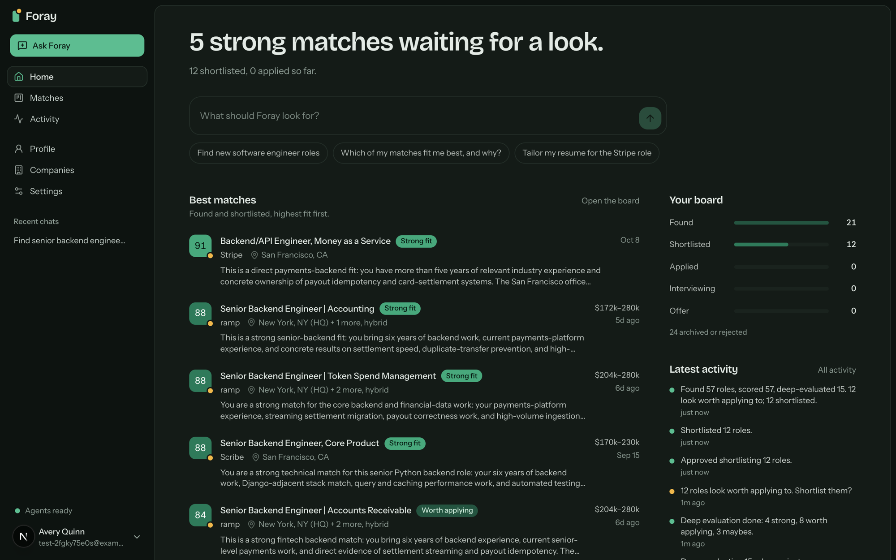

> Every screenshot here is a real run against live job boards, made with a throwaway demo
> account and a fictional resume ("Avery Quinn"). That whole search, from 57 postings
> scored to 15 deep reviews and a shortlist of 12, cost $0.33 in model calls.

## Contents

- [A tour](#a-tour)
- [How a search works](#how-a-search-works)
- [Architecture](#architecture)
- [Quickstart](#quickstart)
- [Models and cost](#models-and-cost)
- [Commands](#commands)
- [Development](#development)
- [Roadmap](#roadmap)

## A tour

### Ask in chat, approve before it spends

The chat agent turns a request into a search with a brief (roles, level, places, remote,
companies), starts it as a background run, and shows it as a live card. When the search
reaches the expensive step, it stops and asks: here are the 15 roles worth a closer look,
here is what reviewing them will cost on which model. The agent reports back in the same
chat when the run needs you or finishes.

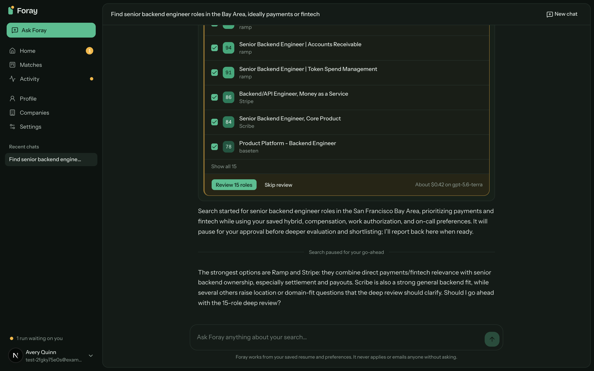

### Why a role fits, with receipts

Every deep-reviewed match gets a page that argues its case: the posting's requirements
one by one, each with the line of your resume that meets it (or the gap, rated learnable
or disqualifying), and verdicts on level, location and pay. One click tailors your resume
for the role: the model may only reorder, select and rephrase what your resume already
says, a verifier traces every claim back to a fact, unsupported lines are reverted, and
the result renders to PDF with a change log.

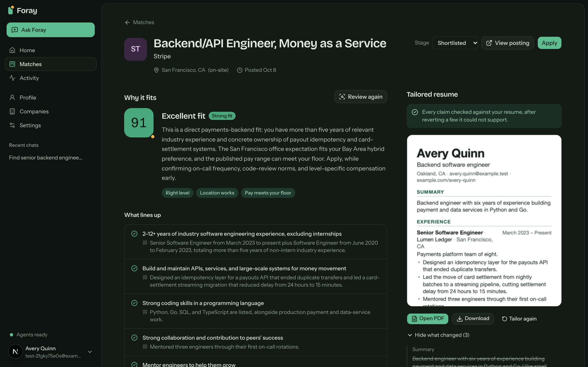

<p align="center">
  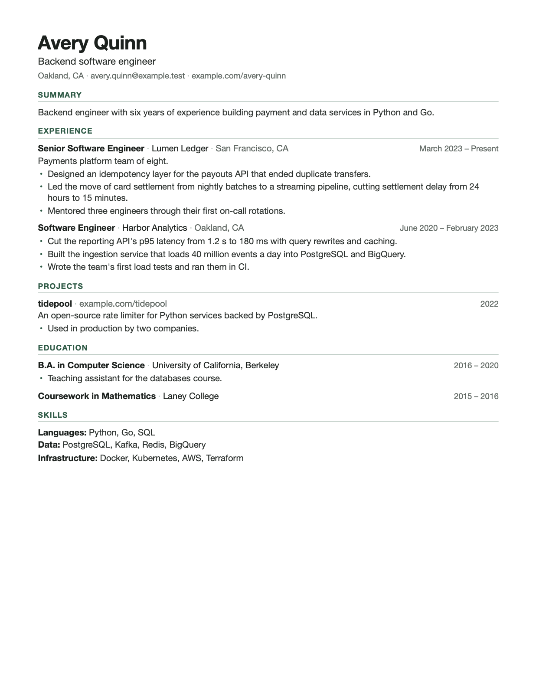
</p>

### Your pipeline

Matches land on a drag-and-drop board (Found, Shortlisted, Applied, Interviewing, Offer)
or a filterable list. Postings that score under your threshold are archived with a note
instead of cluttering the board.

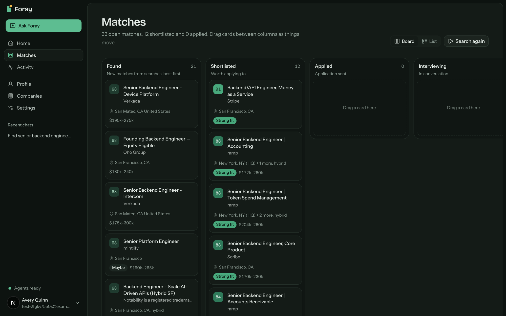

### Everything the agents did

Every run and every step is recorded: what was found, scored, archived, reviewed and
approved, what it cost and how long it took.

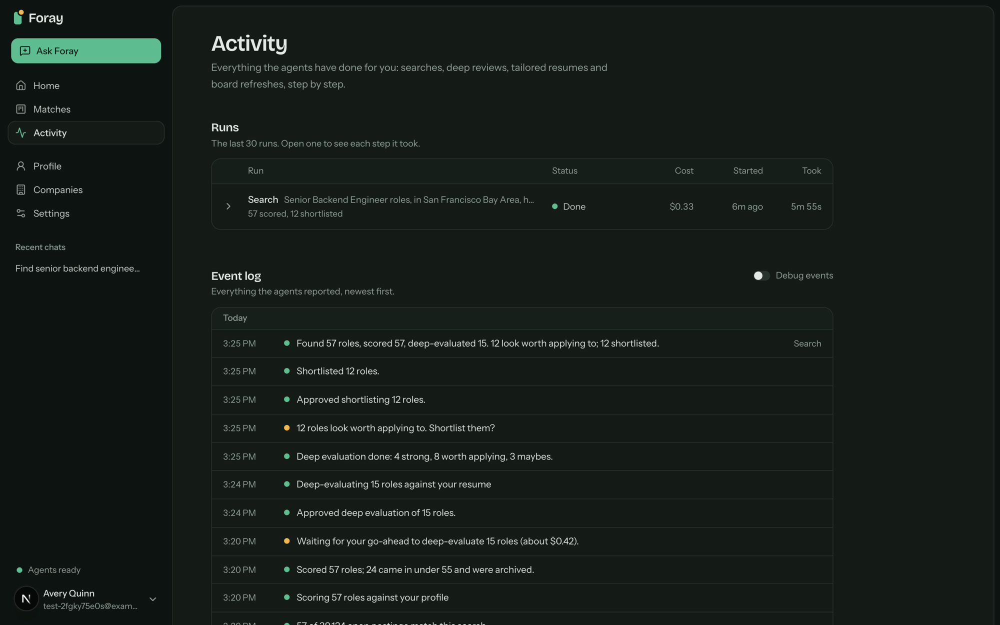

### The boards Foray watches

A shared registry of company job boards on Greenhouse, Lever, Ashby, Workable, Recruitee
and Gem, refreshed every six hours into a local mirror (closed postings are kept, marked
closed). Add a company by name, website or board link, or just mention it in chat; career
pages without a known board fall back to LLM extraction.

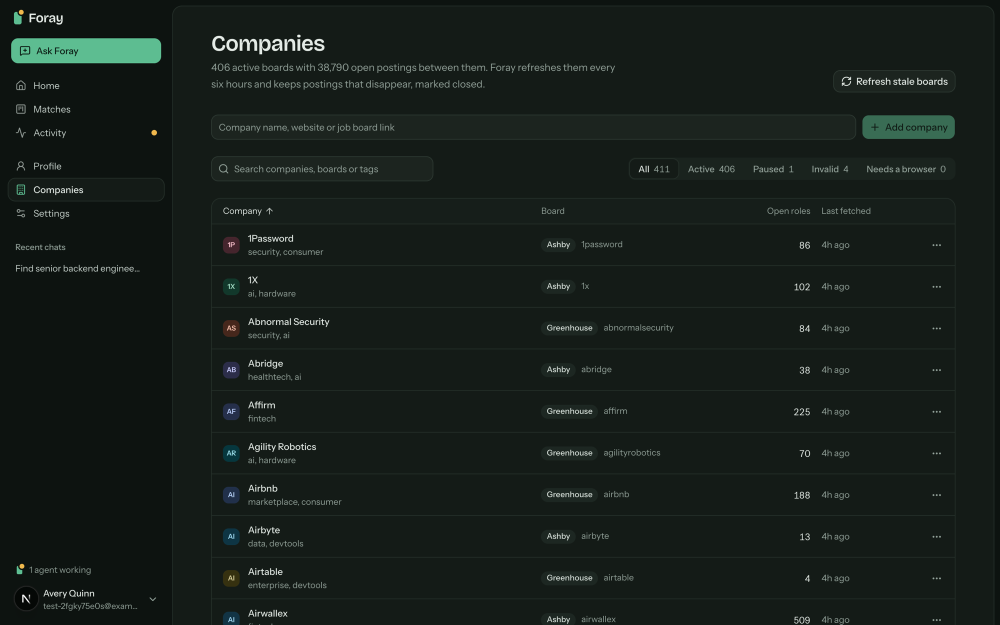

### Your profile and settings

Your resume becomes structured facts that every score, review and tailored resume is
judged against; you can edit them, and each save keeps the version before so tailored
resumes can still cite what they were built from. Settings hold autonomy, the archive
threshold, how many matches get a deep review, model spend this month, model
configuration, worker status and appearance (dark by default, light, or follow the
system).

<table>
  <tr>
    <td>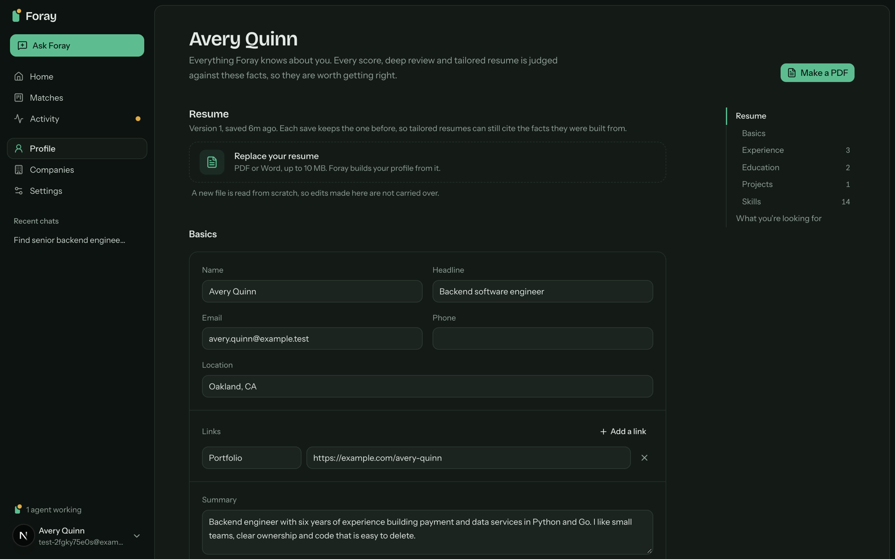</td>
    <td>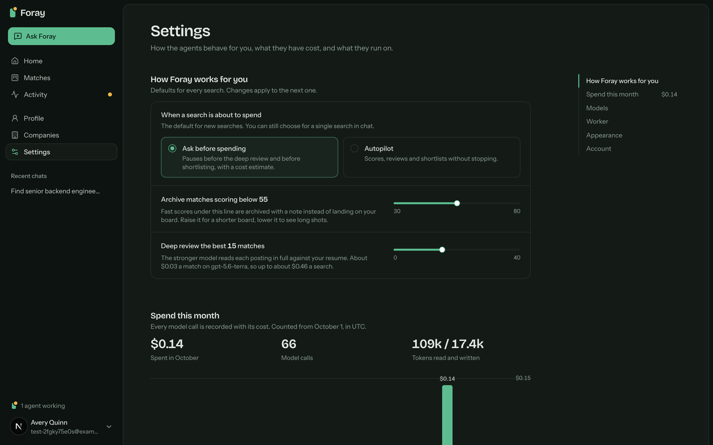</td>
  </tr>
</table>

## How a search works

A search is one background run that moves through phases and pauses at two gates unless
you choose autopilot.

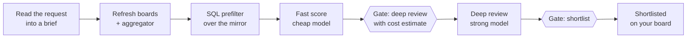

1. **Read the request** into a brief and title terms. A request for entry-level roles at
   one company overrides your saved level, roles, places and companies for that run only.
2. **Refresh** the named companies' boards (registering a board the first time a company
   is mentioned), or every stale board for a broad search, and query the aggregator.
3. **Prefilter** the local mirror in SQL, one posting per role.
4. **Fast score** every new candidate with a cheap model; archive what falls under your
   threshold.
5. **Gate:** the top N unreviewed matches, with a cost estimate from the price sheet.
6. **Deep review** with a strong model: requirement-by-requirement evidence from your
   resume, gaps, and fit on level, location and pay.
7. **Gate:** the matches the review recommends move to Shortlisted.

Tailoring is separate and on demand, and every slow action (tailoring, PDF rendering,
board refreshes, adding a company) is its own run with a live card.

## Architecture

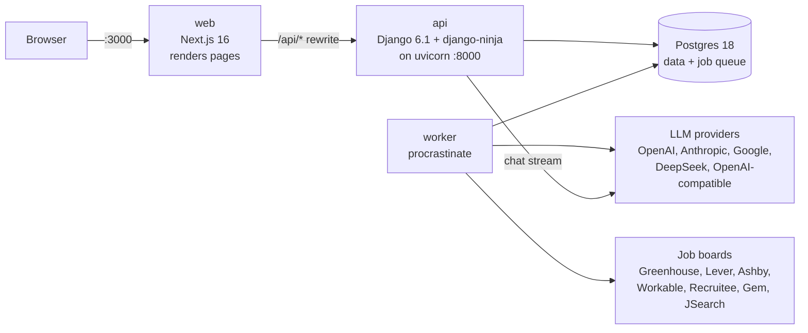

Four processes, the same in development and production:

| Process | What it does |
|---|---|
| **Postgres 18** | All data, plus the procrastinate job queue. Runs in Docker. |
| **web** (:3000) | Next.js 16. It only renders: each page reads one Django page endpoint, client components call Django through a typed client, and every `/api/*` request is rewritten to Django. The browser only ever talks to :3000. |
| **api** (:8000) | Django 6.1 with django-ninja on uvicorn. Owns the data, sign-in, the JSON API and the streaming chat agent. |
| **worker** | One procrastinate process for searches, scoring, deep reviews, tailoring, PDF rendering (headless Chromium) and board refreshes. |

Some things worth knowing about how it is built:

- **Heavy work is a run, never inline in a request.** An endpoint inserts the run and
  defers its first job in one transaction and answers `202`; progress events feed the
  activity log, the chat's live cards and one shared poll in the UI.
- **Approval gates are continuations.** A step that needs a decision records the request
  and returns; deciding defers the next step in the same transaction, so nothing holds a
  worker while you think.
- **Ask for a purpose, never a model.** Code asks for `score`, `evaluate`, `tailor`,
  `chat` and so on; which provider and model serve each purpose is configuration, and
  vendor quirks live in one module. Every request goes through a ledger that records its
  cost and enforces the monthly budget.
- **Per-user by construction.** Every domain row carries a user, and per-user models
  refuse unscoped queries, so the single-user app is already shaped for SaaS.
- **Types flow one way.** Django's OpenAPI schema generates the frontend's TypeScript
  types, and `pnpm check` fails if they drift.
- **Outbound HTTP goes through one guarded client** that refuses private and metadata
  addresses on every hop and caps response sizes.

[DESIGN.md](DESIGN.md) records the settled decisions, invariants and data model;
[CLAUDE.md](CLAUDE.md) has the working conventions.

### Tech stack

| Layer | Tools |
|---|---|
| Frontend | Next.js 16, React, TypeScript 5.9, Tailwind, shadcn/ui (Base UI), AI SDK 7 (`useChat`), dnd-kit |
| Backend | Python 3.14 (uv), Django 6.1, django-ninja 1.7, pydantic-ai 2.54, procrastinate, Playwright (PDF rendering) |
| Data | Postgres 18 |
| Quality | pytest with golden files and stream contract tests, Vitest, ruff, pyright, ESLint |

## Quickstart

Requires Node 24+ and pnpm 10, Python 3.14 and [uv](https://docs.astral.sh/uv/), Docker
Desktop, and Google Chrome (used headlessly to render resume PDFs; or install Playwright's
Chromium with `cd backend && uv run playwright install chromium`; the worker container
brings its own).

```bash
pnpm install
(cd backend && uv sync)  # the Python backend's virtualenv
cp .env.example .env     # set SECRET_KEY, LLM_DEFAULT and that provider's API key
pnpm db:up               # Postgres 18 in Docker
pnpm db:create           # the foray_app database
pnpm db:migrate
pnpm seed:companies      # 400+ verified company job boards (add --fetch to fill the mirror now)
pnpm dev:all             # web on :3000, api on :8000, and the background worker
```

Open http://localhost:3000, create an account, and drop your resume on the home page.
Foray asks a few questions about what you're looking for, then you can start searching.

The worker does all the heavy lifting. If a search seems stuck, the sidebar says
"Worker offline" and tells you to run `pnpm dev:worker`.

To try everything without spending anything, set `LLM_FAKE=1` (with `DEBUG=true`): every
model becomes a deterministic fake at $0.

To run the production images locally instead: `pnpm docker:prod` (stop `dev:all` first;
it wants :3000 too).

<details>
<summary>Bringing over data from the TypeScript version</summary>

Foray ran on a TypeScript server (Next.js plus a Node worker) until October 2026, with its
data in a database named `foray`. The import copies everything (your account and password,
preferences, resumes, documents, matches, runs, the ledger) into `foray_app`, all or
nothing, and never writes to the old database or its files. Instead of `pnpm seed:companies`:

```bash
# in .env: LEGACY_DATABASE_URL=…/foray, LEGACY_STORAGE_DIR=<the old app's data/ folder>
pnpm db:backup-legacy    # a dump, a file manifest and a marker in BACKUP_DIR
pnpm db:import-legacy    # every check runs inside the import's transaction
pnpm db:verify-import    # re-runs the checks
pnpm db:verify-import --password-prompt   # in your own terminal: checks your old password
pnpm db:mark-cutover     # this import is now the real data
```

Mark the cutover before you start using the app. Until then `import_legacy --replace` and
`reset_app_db` still work, and either one discards everything in `foray_app`, including
anything you made since the import; once it is marked, both refuse. Sessions are not carried
over: you sign in once with the same email and password.

</details>

## Models and cost

There is no default vendor. Set `LLM_DEFAULT=provider:model` and override per purpose
(`LLM_CHAT`, `LLM_SCORE`, `LLM_EVALUATE`, `LLM_TAILOR`, …); `.env.example` carries a price
sheet. Every call is recorded in the `llm_calls` ledger, and **Settings, Spend this
month** breaks it down by purpose and model. Calls stop for the month at
`LLM_MONTHLY_BUDGET_USD` ($90 by default). `pnpm llm:smoke` makes one call per purpose to
check your keys, and `pnpm llm:bakeoff` compares models on fixed fixtures.

Measured costs with the current OpenAI configuration (GPT-5.6 Luna for bulk work, Terra
for judgment):

| Work | Cost |
|---|---|
| Fast score | well under a cent per posting |
| Deep review | about 3 cents per role |
| A full search (57 scored, 15 deep-reviewed, 12 shortlisted) | $0.33 |
| A tailored resume | a few cents to ten |

## Commands

| Command | What it does |
|---|---|
| `pnpm dev:all` | web, api and worker in watch mode |
| `pnpm db:up` / `db:create` / `db:migrate` | start Postgres / create `foray_app` / apply Django migrations |
| `pnpm seed:companies` | load the verified company boards |
| `pnpm test` | Vitest (frontend helpers) and pytest (the backend, on its own test database) |
| `pnpm lint` / `typecheck` | ESLint and ruff / `tsc --noEmit` and pyright |
| `pnpm check` | everything above, plus a check that the generated API types are current |
| `pnpm api:types` | regenerate the OpenAPI schema and the frontend's types from it |
| `pnpm llm:smoke` | one call per configured purpose, to check keys and pricing |
| `pnpm llm:bakeoff` | compare models on fixed scoring fixtures (cost, latency, agreement) |
| `pnpm fetch:board` / `verify:boards` | see what an adapter makes of one board / check that board slugs are real |
| `pnpm auth:set-password <email>` | set a forgotten password at a hidden prompt |
| `pnpm docker:prod` | Postgres, migrate, api, worker and web from the production images |

## Development

```
backend/
  foray/            the Django project: settings, env validation, the API, middleware
  apps/
    core/           the async-to-ORM bridge, scoping, errors, HTTP client, storage, throttles
    accounts/       users, sessions, preferences and settings
    llm/            purposes, providers, reasoning knobs, the cost ledger and budget
    jobs/           companies, postings, and one adapter per job board in sources/
    matching/       searches, fast scoring, deep review, shortlisting
    resumes/        parsing, extraction, tailoring, verification, PDF rendering
    runs/           runs, steps, events, approvals and the worker
    chat/           the streaming chat agent and its tools
    pages/          one read endpoint per Next page, each with a query budget
  tests/            pytest, one folder per app, plus fixtures, goldens and contract tests
src/
  app/              Next pages only (no route handlers, no server actions)
  components/       UI
  lib/api/          the typed client and the generated schema
```

Tests never touch the dev database or the network: pytest builds its own database from
the migrations, ignores `.env`, and blocks every non-loopback connection, so no test reads
your keys or spends. Goldens pin prompts, adapter output and the chat stream protocol byte
for byte. Run `pnpm check` before committing.

## Roadmap

- **Phase 1: find, rank, tailor.** Done, and running on the Django backend since
  October 2026.
- **Deployment.** Next up: the same four containers in the cloud behind a TLS front,
  with object storage for documents and sign-up closed until it's ready.
- **Phase 2: apply.** A browser agent that fills in applications on the common applicant
  tracking systems and submits only with your approval of the filled form.
- **Phase 3: outreach.** Recruiter email over Gmail, with reply tracking and an approval
  for every send.
- **Phase 4: SaaS hardening.** Usage billing off the ledger, per-user company follows,
  hosted browsers, retention policy.
